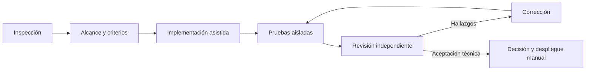

# Desarrollo asistido por IA: ingeniería con agentes

## Propósito y alcance de la evidencia

Se utilizó IA para acelerar inspección, diseño, implementación y revisión de un
monitor local de cuotas, manteniendo requisitos explícitos, decisiones de
arquitectura, seguridad, pruebas reproducibles y aceptación humana. Un resultado
de un agente no equivale a una prueba ni sustituye una revisión técnica.

Este documento distingue dos fuentes: **el repositorio** demuestra decisiones
implementadas, tests y comandos de verificación; **la descripción del proceso
aportada por el desarrollador** identifica el uso de ChatGPT, OpenCode y la
delegación entre agentes. El historial Git conserva cambios, no transcripciones
ni una atribución fiable de cada línea a un agente. Se consultó el archivo local
`PLAN.md` como contexto histórico para redactar este documento; no está
versionado ni se publica como fuente de verdad: prevalecen el código y la
documentación vigente.

## Herramientas y responsabilidades

- **ChatGPT y OpenCode como herramientas de desarrollo:** según el desarrollador,
  se usaron para análisis, planificación y trabajo asistido en el repositorio.
  No hay en el proyecto registros que permitan verificar qué modelo intervino,
  qué agente redactó una línea concreta ni qué conversación produjo un cambio.
- **Agentes con encargos delimitados:** el proceso relatado incluye implementación
  y revisiones independientes. Las pruebas y correcciones resultantes son
  inspeccionables; la identidad exacta de cada revisor no se deduce de Git.
- **Herramientas locales:** Cargo, rustfmt, Clippy, pruebas Rust, Python y tests
  operativos con proveedores y transportes simulados. Los comandos reproducibles
  y las verificaciones fechadas figuran en [validación](validation.md).

El [plugin OpenCode](opencode.md) es **parte del producto** —presenta cuotas—;
no es evidencia, por sí solo, de haber utilizado OpenCode para desarrollarlo.

## Flujo aplicado

El flujo descrito por el desarrollador fue inspeccionar el árbol real y sus
cambios locales; definir alcance y criterios de aceptación; dividir tareas;
implementar y probar con fixtures; solicitar revisión independiente; corregir;
volver a verificar; y decidir manualmente la aceptación y el despliegue. No fue
una cadena completamente autónoma: la coordinación, el alcance y las acciones
sobre la instalación quedaron bajo supervisión humana.

## Caso de estudio: notificaciones de cuotas

### Problema y decisiones

Las alertas iniciales de escritorio combinaban reglas de umbral con SQLite y
entrega desde el scheduler. Añadir ntfy directamente allí habría mezclado
reintentos HTTP, locks y detección de cuotas. El diseño separó observaciones
(`scheduler`), decisiones deterministas (`notifications::policy`), estado durable
transaccional (`storage`) y entrega (`notifications::runtime` y transportes).
Se eligieron threads y colas acotadas en vez de incorporar un runtime async;
la entrega sale de `writer.lock`. [Arquitectura](architecture.md) y
[notificaciones](notifications.md) describen el contrato actual. La planificación
por fases y sus criterios de aceptación fueron relatados por el desarrollador;
el plan local histórico no prueba por sí mismo el orden exacto de ejecución.

### Dos hitos y revisión (según el desarrollador)

La cronología y los hallazgos proceden del relato del desarrollador: Git permite
verificar el resultado técnico, no el orden de las revisiones ni su autoría.

En el **primer hito**, la política legacy pasó a un módulo propio; workers
independientes añadieron Desktop y ntfy con límites de tiempo, reintentos y
deduplicación SQLite. El desarrollador informó seis hallazgos de revisión.
Esta tabla relaciona ese relato con mitigaciones observables, **sin atribuir
cada corrección a un agente identificado**:

| Hallazgo informado | Riesgo y mitigación verificable |
|---|---|
| Regresión de APIs públicas | Cambiar el contrato de llamadas externas; `tests/core.rs` y `tests/additional.rs` prueban actualizaciones con notificaciones desactivadas. `scheduler.rs` conecta las APIs de actualización con el runtime de entrega, pero esos tests no verifican esa entrega. No se conserva aquí el reporte original para comprobar el detalle de la regresión. |
| Apertura bloqueante de FIFO | Detención al leer credenciales especiales; `ntfy.rs` usa `O_NONBLOCK` y prueba FIFO sin escritor. `go_oauth.rs` contiene la misma protección para su credencial, incorporada en una auditoría posterior. |
| Pánico al crear workers | Caída de la consulta por un destino opcional; `Runtime::from_config_simulating_spawn_failure` y el test del scheduler verifican degradación sin impedir actualizar cuotas. |
| TTL y `Retry-After` incompletos | Reintentos prematuros o avisos caducados; `runtime.rs` mantiene deadline monotónico y tests para TTL y esperas que exceden la vida restante. |
| Exceso de logs | Repetición de errores retenidos por backoff; `EventLogger` limita eventos de ciclos omitidos y `tests/log_events.rs` prueba las transiciones. |
| Parsing insuficiente de curl | Fixtures que no representarían la publicación real; cuando `curl` está disponible, `ntfy.rs` prueba un POST real contra **loopback local** y la interpretación de la respuesta, sin ntfy.sh. |

En el **segundo hito** se añadieron umbrales configurables, overrides exactos,
estado de episodios en SQLite, renovación con evidencia temporal, recuperación
confirmada y alertas por incidentes de consulta. Según el desarrollador, la
revisión detectó, entre otros, un interruptor de renovación asociado al evento
equivocado, candidatos de recuperación no interrumpidos por errores o ventanas
ausentes, herencia indebida entre duraciones y pérdida de precisión en umbrales
decimales. El código actual usa `quota_renewed` por separado, interrumpe esos
candidatos y conserva umbrales `f64`; `tests/policy_storage.rs` y los tests de
`policy.rs` protegen esos casos. Es evidencia de la **corrección final**, no un
registro independiente de quién encontró cada defecto.

### Validación, resultado y límites

La suite offline cubre umbrales, migración repetida sin replay, reinicios,
incidentes, backoff, transportes lentos, credenciales y apagado. Se ejecutan
`cargo fmt --check`, Clippy con advertencias denegadas, `cargo test` y
`tests/operations.py`; los resultados fechados y comandos adicionales constan
en [validación](validation.md). El desarrollador indica que probó y desplegó
manualmente el sistema en Fedora. Los tests del repositorio no prueban por sí
solos el estado actual de esa instalación; este documento no lee el servicio.

La entrega es **best-effort**, no exactamente una vez: un proceso puede terminar
tras confirmar la deduplicación y antes de publicar. `refresh` dispone de un
presupuesto breve; una cola saturada o un 429 pueden perder un aviso. Esas
limitaciones se documentan en [notificaciones](notifications.md); no se atribuye
garantía de entrega durable al uso de agentes.

## Responsabilidad del desarrollador

La IA asistió con propuestas, código, tests y revisión; no corresponde describir
el repositorio como trabajo enteramente manual ni enteramente generado. La
persona a cargo definió alcance y aceptación, supervisó decisiones como SQLite
transaccional y transportes best-effort, evaluó los hallazgos, controló Git y
realizó cualquier configuración y despliegue real. Los agentes facilitaron
tareas acotadas, pero no asumen responsabilidad operativa ni sustituyen la
validación del comportamiento.

## Evidencias verificables

| Recurso | Qué permite comprobar |
|---|---|
| [`src/notifications/policy.rs`](../src/notifications/policy.rs) | Política y estado lógico separados de HTTP y SQL; tests deterministas. |
| [`src/storage.rs`](../src/storage.rs) | Tablas aditivas y transacciones para estado y deduplicación. |
| [`src/scheduler.rs`](../src/scheduler.rs) | Intentos reales y entrega después de liberar el lock. |
| [`src/notifications/runtime.rs`](../src/notifications/runtime.rs) | Colas acotadas, TTL, fallos de workers y reintentos. |
| [`src/notifications/ntfy.rs`](../src/notifications/ntfy.rs) | Transporte aislado, credenciales por stdin y test curl en loopback cuando `curl` está disponible. |
| [`tests/policy_storage.rs`](../tests/policy_storage.rs) | Migración, episodios, ventanas ausentes y deduplicación sin base real. |
| [`tests/operations.py`](../tests/operations.py) | Pruebas de procesos, locks, fallos de entrega y aislamiento. |
| [`tests/log_events.rs`](../tests/log_events.rs) | Eventos de consultas reales y backoff sin repetir logs. |
| [`docs/notifications.md`](notifications.md) y [`docs/validation.md`](validation.md) | Reglas, límites y verificaciones reproducibles. |

Estas rutas evidencian el **resultado técnico**. Ni sus tests ni los commits
registran transcripciones o una asignación verificable de tareas a modelos o
agentes concretos; la descripción del **proceso agéntico** procede del
desarrollador. No se publican conversaciones, prompts privados ni identificadores
de sesiones.

## Aprendizajes

La delegación ayudó a separar políticas, persistencia, runtime y revisión,
pero las propuestas requirieron pruebas y examen humano. FIFO, locks,
reintentos y migración mostraron que concurrencia y persistencia no se validan
aceptando una respuesta textual: hacen falta fixtures aislados y escenarios
deterministas. La revisión posterior encontró defectos que una primera
implementación no había cubierto. La aceptación, la seguridad y el despliegue
siguen siendo responsabilidad humana.
